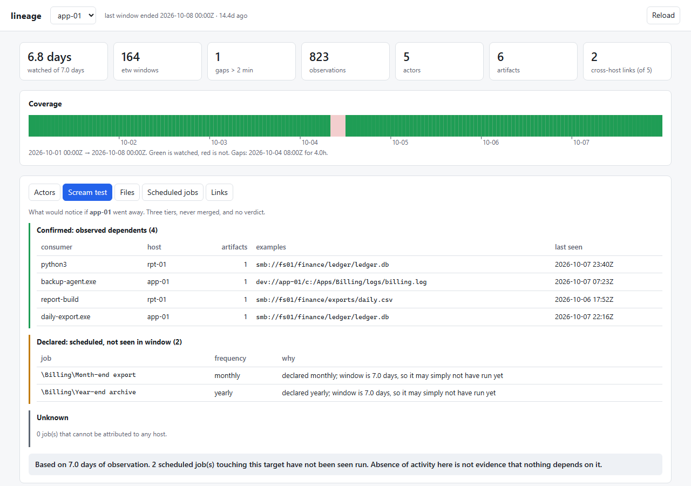
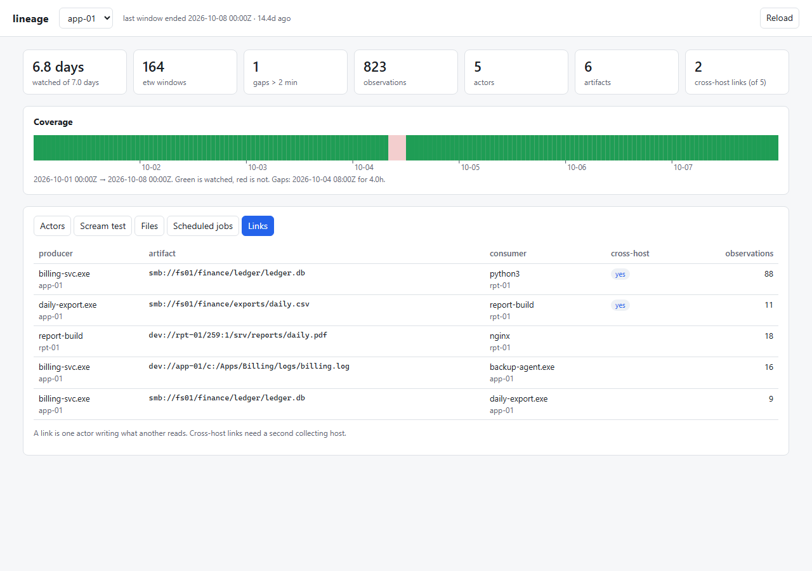
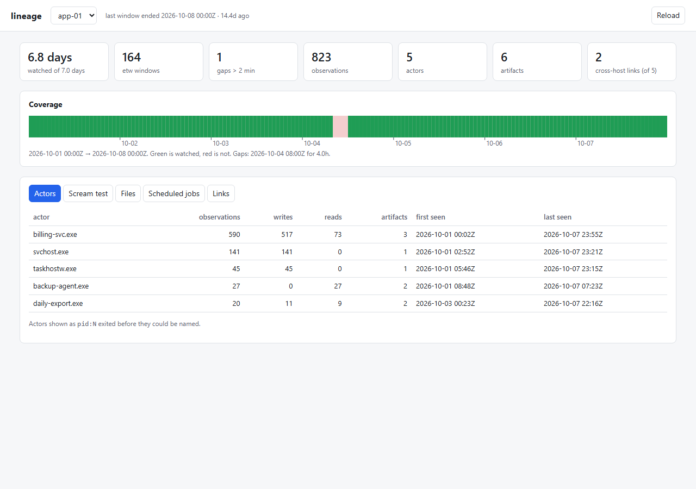
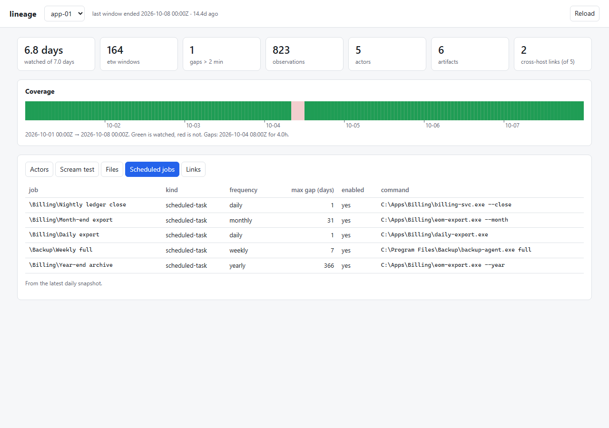
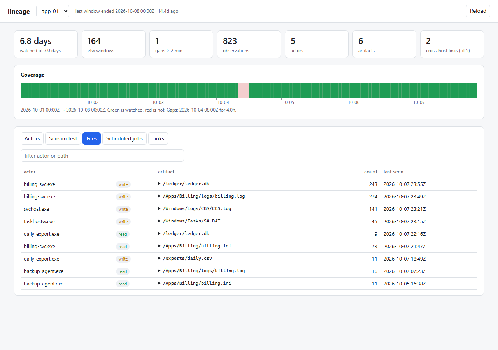

# lineage

**Find out what your estate actually depends on, then manage it.** A read-only
agent that watches which programs read and write which files across Windows and
Linux, remembers it for months, and answers "what breaks if I turn this off?".
The same agent evaluates declarative policy on the endpoint itself, which
is the base for inventory, patching and compliance later.

## Status

**v0.1.0, alpha.** 111 tests; cron conformance **58/58** against croniter
(`tools/conformance.py`, gated in CI). Nothing takes an action on any endpoint,
on purpose. Collecting unattended on a Windows 10 guest since 2026-10-15.

| | |
|---|---|
| Relevance engine, Windows inspectors, agent, server | working |
| D1 job inventory · D2 seasonal diff · D3 ETW + `/proc` taps · D4 storage identity · D5 store + scream test | working |
| `lineage.collect`: D1–D5 as an hourly read-only cycle, rolling ETW session, process names | **running unattended** |
| Deploy/pull to Windows guests through the Proxmox guest agent (`tools/pve.py`) | working |
| Read-only web console over pulled data (`lineage.web`) | working, loopback only |
| A cross-host link formed unaided (Windows write, Linux read) | not yet: needs a second host |
| Signed policy, auth, any action | not started |

Next steps and what is deliberately deferred: [ROADMAP.md](ROADMAP.md).

## Screenshots

The web console (`lineage.web`) over the built-in demo fleet (`python tools/demo.py`).
Every host, path and job in them is made up; real pulled data names every program
and file on a machine, so it stays out of screenshots.



| | |
|---|---|
|  |  |
| Links: one actor writing what another reads. Two cross the host boundary through a file share. | Actors: every program seen touching a file, with a coverage timeline above. The red block is four hours the host was off. |
|  |  |
| Scheduled jobs and how far apart each one can run. The monthly and yearly ones are why a seven-day window cannot clear a host. | Files: every observed read and write, searchable by program or path. |

## Output

A real report from the first unattended Windows guest, after about two minutes of
collection (hostname replaced):

```
win-a                etw             2 windows  watched 1.7 minutes of 1.7 minutes  last 2026-10-15T01:45

win-a                   653 edge rows       802 observations    26 actors

busiest writers:
      106  win-a            MicrosoftEdgeUpdate.exe                  105 artifact(s)
       40  win-a            OneDrive.Sync.Service.exe                28 artifact(s)
       30  win-a            MicrosoftEdgeUpdateSetup_X86_1.3.291.9.e 28 artifact(s)
       20  win-a            mousocoreworker.exe                      2 artifact(s)
       15  win-a            CompatTelRunner.exe                      15 artifact(s)

Scream test — win-a

  CONFIRMED   observed dependents                      8
    • MicrosoftEdgeUpdate.exe    on win-a        reads   4 artifact(s)
        dev://win-a/c:/MicrosoftEdgeUpdate.ini
  ...
  DECLARED    scheduled, not seen in window          240
    • \AMD Install Manager - Check For U daily     declared daily; window is 1.7 minutes, so it may simply not have run yet
  ...
  Based on 1.7 minutes of observation. 240 scheduled job(s) touching this target have not been seen run.
  Absence of activity here is not evidence that nothing depends on it.
```

The last line is the product. A tool people decommission machines with must say
what it has not seen.

## Getting Started

### Quick start

1. Download the repository (Code → Download ZIP) and unzip it anywhere.
2. **Windows:** double-click `Setup.cmd`. **Linux/macOS:** `sh setup.sh`.

The script checks for Python 3.9+ and **asks before installing it** (winget on
Windows, apt/dnf/brew elsewhere), runs the self-test, evaluates this machine
against the example policy with nothing sent anywhere, and leaves a launcher
(`Lineage.cmd` / `lineage.sh`) that does it again. Rerunning it skips what is
done. If anything fails it says what to do in one sentence and keeps details in
`setup.log`.

### Step by step

These are exactly the commands the quick start runs.

1. **Python 3.9 or newer**, stdlib only, no packages.
   ```
   py -3 --version          # Windows
   python3 --version        # Linux/macOS
   ```
   ```
   Python 3.13.14
   ```
2. **Self-test** (no test framework needed):
   ```
   py -3 tests\run.py
   ```
   ```
   110 passed, 0 failed
   ```
3. **Use the example policy** as this machine's cached policy:
   ```
   mkdir var\agent-state
   copy var\policy.json var\agent-state\policy.json
   ```
4. **Evaluate this machine**, offline:
   ```
   py -3 -m lineage.agent --once --offline --state var\agent-state
   ```
   ```
   [lineage] 11 evaluated, 1 failed, policy v2
   ```
   The answers are in `var\agent-state\last-report.json`. The failure is
   BitLocker status, which needs administrator. It is reported as an error with
   `value: null`, never as `false`.

**Trip-ups:** on Windows, `python` may be the Microsoft Store alias and do
nothing; use `py -3`. A Python installed a moment ago is not on PATH until you
open a new window. On Linux the example policy is Windows-flavoured, so most
items report an error rather than an answer. That is correct.

## Usage

**Policy and inventory** (agent and server, loopback only, no auth yet):

```
python -m lineage.server --root ./var           # publishes var/policy.json on :8770
python -m lineage.agent --once                  # evaluate, report in
curl http://127.0.0.1:8770/v1/inventory
```

A policy item is one expression; the inspectors are listed in
[docs/api.md](docs/api.md):

```json
{ "id": "chrome-needs-update", "kind": "applicability",
  "relevance": "installed(\"Google Chrome\") and package_version(\"Google Chrome\") < \"139.0\"" }
```

**Discovery**, one read-only cycle; schedule it hourly, elevated:

```
python -m lineage.collect run --home C:\ProgramData\lineage          # Windows, administrator
python3 -m lineage.collect run --home /var/lib/lineage               # Linux, root
python -m lineage.collect report --store C:\ProgramData\lineage\graph.db --host <hostname>
python -m lineage.collect merge central.db host-a.db host-b.db       # repeatable, never double-counts
```

**Proxmox Windows guests**, through the guest agent, nothing pre-installed:

```
set PVE_HOST=<node>  &  set PVE_PASSWORD=<root@pam password>
python tools\pve.py deploy <vmid>               # embeddable Python + lineage + hourly SYSTEM task
python tools\pve.py pull <vmid>                 # store + snapshots -> var\fleet, merged into central.db
```

**Web console** over pulled data, read-only, loopback only (no data yet?
`python tools/demo.py` builds a made-up fleet in `var\demo` to point it at):

```
python -m lineage.web --fleet varleet         # http://127.0.0.1:8771
```

Coverage timeline with gaps, actors, the scream test's three tiers, a file
search, declared jobs and links.

**One-off ETW capture** with a summary, elevated: `python tools\etw_capture.py --seconds 60`.

Runbook (deploy, back up, upgrade, remove): [docs/running.md](docs/running.md).

## Building from source

There is nothing to compile. `pip install -e .` adds `lineage-agent` and
`lineage-server` commands; otherwise run modules in place as above.

```
pip install pytest==8.3.3 pyflakes==3.2.0 croniter==6.0.0   # test tools only
python -m pyflakes lineage tools tests
python -m pytest -q
python tools/conformance.py          # cron conformance: 58/58, fails below the baseline
```

CI runs all three on Linux and Windows, Python 3.9 and 3.12
(`.github/workflows/ci.yml`).

## Documentation

| | |
|---|---|
| [docs/architecture.md](docs/architecture.md) | the parts and the data flow |
| [docs/design.md](docs/design.md) | why it is shaped this way: one relevance engine, read-only first, prior art |
| [docs/DISCOVERY.md](docs/DISCOVERY.md) | the discovery track, D1–D5 |
| [docs/api.md](docs/api.md) | the agent ↔ server wire protocol |
| [docs/data-model.md](docs/data-model.md) | `graph.db`, snapshots, state files |
| [docs/running.md](docs/running.md) | runbook |
| [docs/findings.md](docs/findings.md) | what real hardware taught us |
| [docs/proxmox-guest-agent.md](docs/proxmox-guest-agent.md) | driving Windows guests without SSH or WinRM |
| [docs/SELF-UPDATE.md](docs/SELF-UPDATE.md) | self-update design |
| [docs/HERITAGE.md](docs/HERITAGE.md) | what is reused from opsview, whatdoesthisboxdo, fleetview |
| [CONTRIBUTING.md](CONTRIBUTING.md) | issues, PRs, tests, fixtures |

## Compared with paid tools

Endpoint management suites are enterprise-priced; the smaller patching tools
run about $1,500 a year; the cloud services are per-user and need a tenant; and
dependency-mapping products are priced per device. lineage is MIT, on-prem, needs no
SQL Server or cloud tenant, and today does only the read-only half: inventory,
job discovery and dependency mapping. See [docs/design.md](docs/design.md).

## License

MIT. See [LICENSE](LICENSE).
